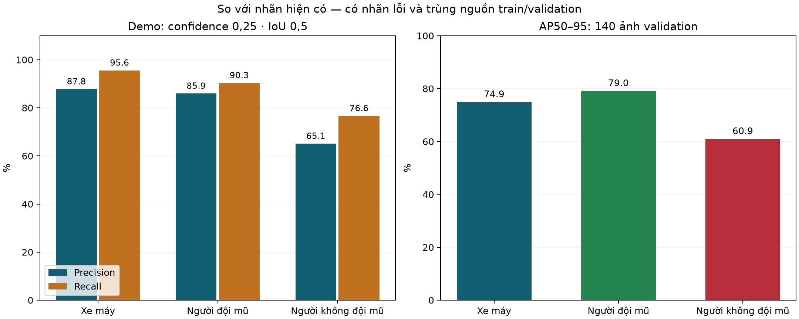

# Đánh giá mô hình hiện tại và hướng huấn luyện tiếp theo

Ngày 13/10/2026. Kiểm tra thực tế qua backend người dùng đang chạy; không sửa checkpoint, cấu hình demo, notebook huấn luyện hoặc dataset gốc.

## Kết luận chính

Mô hình nhận diện xe máy và người đội mũ khá tốt theo nhãn hiện có, nhưng lớp không đội mũ yếu hơn. Tuy nhiên **ưu tiên đầu tiên là sửa dữ liệu/nhãn và cách chia tập**, không phải thêm module hoặc tăng epoch ngay: đã xác nhận 3 ảnh trùng hoàn toàn giữa train/validation và quan sát nhãn gán người đi bộ thành rider không đội mũ, nhãn gộp hai rider hoặc box trùng trên một người.

Không thể hứa cấu hình nào đạt kết quả cao nhất trước khi có validation độc lập và nhãn đáng tin. Các FP/FN bên dưới tính theo annotation hiện có; một phần sai lệch đến từ annotation, không phải lỗi nhận diện thực sự.

## Những gì đã chạy

- Toàn bộ **140 ảnh validation**, 531 đối tượng theo nhãn; qua API đang chạy với imgsz=768, confidence=0,25, lớp 0/1/2. Tập test không được dùng để đánh giá hoặc tinh chỉnh.
- Sáu trường hợp cùng một ảnh đông người có cả hai lớp rider: gốc, tối 35%, sáng 180%, Gaussian blur bán kính 3, giảm độ phân giải cạnh dài còn 320 px, JPEG quality=15. Đây là biến đổi mô phỏng; không thay thế video đêm/mưa thật.
- Hai ảnh âm tính nhân tạo đen/xám; cả hai trả 0 detection. Chưa đại diện cho ảnh âm tính đời thực.
- Hai video giao thông thật, mỗi video 3 giây; một video Việt Nam và một video có cả đội mũ/không đội mũ tại Karachi. Xử lý hoàn tất, health tiếp tục phản hồi. Không có ground truth đầy đủ cho từng frame nên không công bố độ chính xác video.
- Tổng cộng **150 job hoàn thành** thêm vào lịch sử với tiền tố `AUDIT_`; một tệp JPG giả bị từ chối HTTP 415 và không tạo job thành công.
- Chạy thêm validation AP trên cùng 140 ảnh, candidate confidence=0,001, batch=1, rect=False, CPU, IoU=0,7; chỉ chấm lớp 0/1/2. Không thay ngưỡng 0,25 của backend. Bản sao dataset/cache nằm trong Demo.
- 22 kiểm thử tự động qua, Ruff kiểm tra lỗi Python qua. FE trả HTTP 200; chưa có kiểm thử thao tác trực tiếp trong browser.

## Kết quả theo nhãn hiện có

Precision: trong các box dự đoán, bao nhiêu khớp nhãn. Recall: trong các đối tượng có nhãn, tìm được bao nhiêu. Một dự đoán chỉ khớp một GT cùng lớp, IoU≥0,5, ưu tiên confidence cao; box trùng tính FP. Đây là chỉ số tại ngưỡng cố định, không phải AP.

| Lớp | GT | TP | FP | FN | Precision @0,25 | Recall @0,25 | AP50–95 |
|---|---:|---:|---:|---:|---:|---:|---:|
| Xe máy | 248 | 237 | 33 | 11 | 87,8% | 95,6% | 74,9% |
| Người đội mũ | 176 | 159 | 26 | 17 | 85,9% | 90,3% | 79,0% |
| Người không đội mũ | 107 | 82 | 44 | 25 | 65,1% | 76,6% | 60,9% |

Fresh validation: **mAP50=88,6%; mAP50–95=71,6%**. AP50 lớp không đội mũ=75,8%. Các số này chưa phản ánh chắc chắn chất lượng trên video mới vì leakage và lỗi nhãn.

Metadata checkpoint ghi mAP50=90,49%, mAP50–95=73,62%; CSV có 50 epoch và hàng cao nhất nằm ở epoch 50. Metadata epoch trong best.pt đã bị strip thành -1. Không suy đoán epoch lưu best.pt chỉ từ hàng cao nhất. Fresh validation có giao thức mới được ghi rõ (padding vuông, class filter, phiên bản runtime/CPU); không coi chênh lệch 2 điểm là bằng chứng trọng số đã giảm chất lượng.



Recall theo kích thước bbox sau khi scale cạnh dài về 768 px (không phải COCO small/medium/large AP):

| Kích thước | Xe máy | Đội mũ | Không đội mũ |
|---|---:|---:|---:|
| Nhỏ (<32² px) | 13/16 (81,2%) | 5/11 (45,5%) | 12/16 (75,0%) |
| Vừa (32²–96² px) | 106/112 (94,6%) | 48/54 (88,9%) | 38/52 (73,1%) |
| Lớn (≥96² px) | 118/120 (98,3%) | 106/111 (95,5%) | 32/39 (82,1%) |

Nhóm người đội mũ nhỏ chỉ có 11 mẫu, tìm đúng 5; cần thêm dữ liệu để kết luận chắc. Lớp không đội mũ cỡ vừa bỏ sót 14/52 theo annotation; phải rà nhãn trước khi gọi đây là lỗi model.

Trong các FP/FN có 6 cặp ứng viên nhầm đội mũ→không đội mũ và 6 cặp chiều ngược lại dựa trên overlap. Đây là gợi ý để xem ảnh, không phải 12 lỗi phân loại đã được con người xác nhận.

## Phát hiện về dữ liệu — ưu tiên cao nhất

- Train: 1.563 ảnh; 2.535 motorcycle, 1.597 rider_with_helmet, 1.279 rider_without_helmet. Validation: 140 ảnh; 248/176/107 đối tượng. Lệch số lượng giữa hai lớp rider không quá lớn; không nên mặc định thiếu số lượng class 2 là nguyên nhân duy nhất.
- Không tìm thấy dòng nhãn sai định dạng/toạ độ hoặc box vượt ảnh trong lần kiểm tra. **Nhãn đúng cú pháp vẫn có thể sai nội dung.**
- **3 ảnh validation giống byte-for-byte với ảnh train**, cùng nhãn; danh sách SHA256/tên ảnh nằm trong `dataset_audit.json`.
- Nhận diện được **29 video gốc chung**, bao gồm **102/140 ảnh validation** (72,9%). Nhận diện theo tiền tố MOV/mp4 trong tên file; đây là kiểm tra nguồn theo tên, không chứng minh mọi frame là bản sao. Một số ảnh không nhận diện được nguồn nên số chồng nguồn có thể còn thiếu.
- Đã xem 8 ca có lỗi thống kê cao, không phải mẫu ngẫu nhiên để ước lượng tỷ lệ nhãn lỗi toàn dataset.
- `image_75...`: GT1 bao người lái nhìn thấy tóc, chưa thấy mũ trên đầu; GT2 bao người đứng cạnh xe/người đi bộ. Cần rà lại theo định nghĩa rider của đề tài.
- `IMG_5137_MOV-69...`: hai GT2 chồng lên cùng người phụ nữ tại quầy, không ngồi trên xe. Model không phát hiện các box này chưa phải bằng chứng bỏ sót người đi xe không đội mũ.
- `image_213...`: một GT1 bao vùng hai người trên xe. Cần một bbox riêng cho mỗi rider, không gộp hai người khi trạng thái mũ có thể khác.

Ảnh minh chứng nằm trong [báo cáo trực quan](report.html), kèm `manual_review.json`. Nhận xét bằng mắt cần người gán nhãn xác nhận trước khi chỉnh sửa. Không thay đổi nhãn gốc trong phiên này.

## Các tình huống khác

Ảnh stress có 7 xe máy, 5 rider đội mũ, 2 rider không đội mũ. Baseline tìm đủ 14 nhãn, có 2 FP; ảnh tối tìm 13/14, có 1 FP. Ảnh sáng, blur và JPEG nén mạnh mỗi trường hợp phát sinh thêm một FP lớp không đội mũ so với baseline. Chỉ một ảnh nguồn nên không suy rộng thành độ bền với ban đêm, mưa hoặc camera rung.

Video Việt Nam hoàn thành sau khoảng 20.4 giây, video Karachi khoảng 19.5 giây trên CPU, gồm upload/hàng đợi/suy luận/chuyển mã/polling. Không coi đây là benchmark FPS tổng quát. Trên frame Karachi đã xem, rider đội mũ bên phải nhận diện ổn định; người không đội mũ bên trái được nhận ra ở một số frame nhưng có frame bỏ sót, và một số rider phía xa bị nhầm. Chưa có tracking; không cộng box qua frame thành số người vi phạm.

Trong cảnh đông, nhãn vẽ chồng lên nhau và có box trùng. Nhãn chữ chồng là vấn đề hiển thị; box trùng/nhầm lớp là vấn đề detector cần đánh giá riêng. YOLO26 dùng end-to-end/NMS-free; không mặc định đổi IoU sẽ giải quyết box trùng.

## Thứ tự cải thiện và thí nghiệm train đề xuất

1. **Chốt quy tắc gán nhãn rồi làm sạch bản dữ liệu mới.** Mỗi rider một box, mũ phải đang đội trên đầu; phân biệt người đi bộ/người đứng quầy với rider. Rà mũ cầm tay/treo xe, mũ lưỡi trai, box gộp người, box trùng, người bị che đầu và người bị cắt mép. Thống nhất cả phạm vi motorcycle đang chạy/xe đỗ. Các vùng không đủ rõ để xác định mũ cần được đánh dấu rà soát, không tự gán không đội mũ. Không âm thầm bỏ nhãn một đối tượng có thật rồi coi nó là background.
2. **Chia theo video/camera/địa điểm trước khi lấy frame hoặc augmentation.** Gom ảnh trùng/gần trùng cùng nhóm; train/val/test không chung video nguồn. Giữ test khóa lại. Việc chia lại làm kết quả cũ mất khả năng so trực tiếp; train lại trên split mới và đánh giá cùng protocol.
3. **Sửa head trong quy trình train mới thành 3 kênh thật.** Dựng DetectionModel(nc=3) trước khi chèn SCConv, chuyển pretrained weights tương thích; không chỉ gán model.nc=3. Assert trước train, trong trainer, sau epoch đầu và sau nạp best.pt: names đúng 0/1/2, head.nc=3, 6 convolution phân loại có out_channels=3, raw scores có 3 kênh; hai C3k2_SCConv có gradient. Không cắt head checkpoint hiện tại và tuyên bố đã train lại đúng.
4. **So baseline và SCConv công bằng.** E0=YOLO26s baseline đúng 3 lớp, E1=YOLO26s+SCConv đúng 3 lớp; cùng split sạch, imgsz=768, seed=0, optimizer/augmentation và batch cố định phù hợp GPU. Đề xuất thử ngân sách tối đa 150 epoch, patience=30 rồi xem learning curve; đây là điểm bắt đầu thí nghiệm, không phải cấu hình tối ưu đã chứng minh. CSV hiện cải thiện đến epoch 50, nên 50 chưa chứng minh đã hội tụ, nhưng tăng epoch trên nhãn sai không giải quyết nguyên nhân gốc.
5. **Bổ sung ca khó có nhãn sạch.** Rider nhỏ/xa, passenger không đội mũ, che khuất, đầu ở mép, tóc tối/mũ tối, mũ cầm tay, người đi bộ cạnh xe, xe đỗ; thêm camera/địa điểm/ban đêm thật. Thu thập từ dữ liệu mới hoặc TRAIN, không chuyển các ca validation/test đã xem sang TRAIN rồi vẫn giữ chúng để chấm.
6. **Ablation từng yếu tố sau E0/E1.** So 640/768/960 khi GPU cho phép; thử augment sáng/tối, blur/nén vừa phải và sampling ca khó. Không đồng thời đổi kiến trúc, dữ liệu, learning rate và resolution rồi quy mọi cải thiện cho SCConv. Chọn cấu hình theo AP50–95 lớp 2, cùng mAP tổng và P/R. Sau khi chọn mô hình, chọn confidence trên validation sạch theo tradeoff báo nhầm/bỏ sót; không dùng threshold Stage2 hoặc tập test.
7. **Xác nhận ổn định.** Với cấu hình tốt nhất trong phạm vi thí nghiệm, chạy 3 seed (0,1,2), báo trung bình/độ lệch chuẩn và thời gian/VRAM trên cùng phần cứng. Dùng test độc lập một lần sau khi khóa cấu hình. Tập video ngoài miền cần nhãn thủ công đủ rõ, không chỉ nhìn confidence cao để kết luận đúng.

Chưa chạy train hoặc hyperparameter sweep. Không có cơ sở cam kết “cao nhất”; mục tiêu là kết quả tốt hơn và đo được trên dữ liệu độc lập.

## Tái lập và tài liệu

Từ Demo, khi BE đã chạy ở 8000:

```powershell
$env:PYTHONUTF8='1'
.\.venv\Scripts\python.exe backend/audit_current_model.py --output evaluation/audit_lan_sau
.\.venv\Scripts\python.exe backend/evaluate_validation_ap.py --output evaluation/audit_lan_sau
$env:PYTHONPATH='backend'
.\.venv\Scripts\python.exe -m pytest backend/tests -q
```

Lệnh audit thêm job vào lịch sử; thư mục output mới tránh ghi đè báo cáo. Chạy AP riêng khi worker demo không xử lý video nặng để tránh tranh CPU. AP dùng ảnh/nhãn bản sao, cache nằm trong Demo. Kiểm tra SHA256 cuối phiên xác nhận checkpoint không đổi.

Nguồn hướng dẫn: [Ultralytics – metrics](https://docs.ultralytics.com/guides/yolo-performance-metrics/), [training](https://docs.ultralytics.com/guides/model-training-tips/), [tuning](https://docs.ultralytics.com/guides/hyperparameter-tuning/). Các cấu hình tương lai nêu trên là đề xuất thí nghiệm từ phân tích hiện tại, không phải kết quả đã chạy; vẫn giữ Ultralytics tương thích custom, không tự nâng phiên bản.
